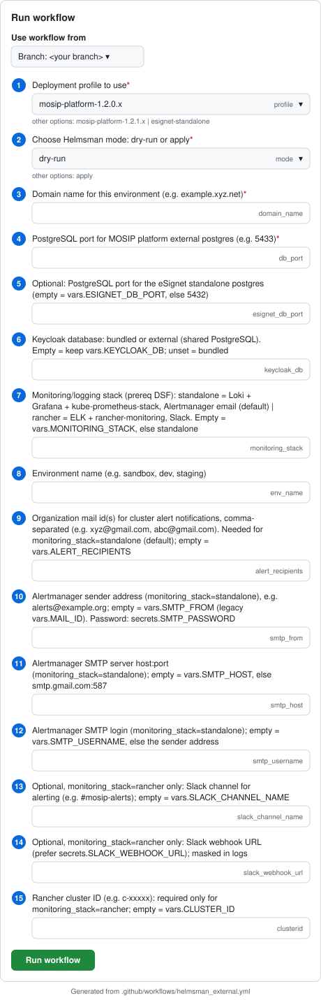

# Helmsman External Deployment Guide

Deploy prerequisites and external dependencies (databases, queues, storage, monitoring) before any MOSIP or eSignet services.

## Overview

The `helmsman_external.yml` workflow runs **two DSFs in parallel**:

| DSF | Deploys |
|-----|---------|
| `prereq-dsf.yaml` | Monitoring + logging (`monitoring_stack`: standalone Loki/Grafana/kube-prometheus-stack by default, or rancher-monitoring + ELK), Istio, httpbin |
| `external-dsf.yaml` | PostgreSQL (init), Keycloak, Kafka, MinIO, plus per profile: SoftHSM, ClamAV, ActiveMQ, landing page (MOSIP) or Redis, captcha (eSignet standalone) |

**Time required:** 20–40 minutes

**Auto-trigger:** On successful completion, this workflow automatically triggers `helmsman_mosip.yml` — but only for MOSIP platform profiles. For the `esignet-standalone` profile, MOSIP is not triggered.

---

## Profile Selection

Choose the profile that matches your deployment target:

| Profile | Use when |
|---------|----------|
| `esignet-standalone` | eSignet standalone — 3 parallel instances (esignet-mock, esignet-mosipid, esignet-sunbird). No full MOSIP stack. |
| `mosip-platform-1.2.0.x` | Full MOSIP platform with Java 11 |
| `mosip-platform-1.2.1.x` | Full MOSIP platform with Java 21 |

The workflow selects `Helmsman/dsf/<profile>/prereq-dsf.yaml` and `Helmsman/dsf/<profile>/external-dsf.yaml` based on this input.

---

## Required Secrets

All secrets are **Environment Secrets** — configure at **Repository → Settings → Environments → `<branch-name>` → Secrets**.

### All profiles

| Secret | Description |
|--------|-------------|
| `KUBECONFIG` | Raw YAML kubeconfig (not base64 encoded) |
| `CLUSTER_WIREGUARD_WG0` | WireGuard VPN config for cluster access |
| `SMTP_PASSWORD` | **`monitoring_stack=standalone` (default)** — SMTP password for Alertmanager alert e-mails |
| `GRAFANA_ADMIN_PASSWORD` | Optional — Grafana `admin` password (random one generated if unset) |
| `SLACK_WEBHOOK_URL` | Optional, `monitoring_stack=rancher` only — Slack alerts |

### eSignet standalone profile only

| Secret | Description |
|--------|-------------|
| `ESIGNET_CAPTCHA_SITE_KEY` | Google reCAPTCHA site key for the main esignet namespace |
| `ESIGNET_CAPTCHA_SECRET_KEY` | Google reCAPTCHA secret key for the main esignet namespace |

> For MOSIP-ID1, MOSIP-ID2, and Sunbird namespace captcha secrets, see [ESIGNET_STANDALONE_DEPLOYMENT_GUIDE.md](ESIGNET_STANDALONE_DEPLOYMENT_GUIDE.md).

### MOSIP platform profiles only

reCAPTCHA v2 keys for each MOSIP service domain — add as **Environment Secrets**:

| Secret | Domain |
|--------|--------|
| `PREREG_CAPTCHA_SITE_KEY` / `PREREG_CAPTCHA_SECRET_KEY` | `prereg.<your-domain>` |
| `ADMIN_CAPTCHA_SITE_KEY` / `ADMIN_CAPTCHA_SECRET_KEY` | `admin.<your-domain>` |
| `RESIDENT_CAPTCHA_SITE_KEY` / `RESIDENT_CAPTCHA_SECRET_KEY` | `resident.<your-domain>` |

> Get reCAPTCHA keys from [Google reCAPTCHA Admin Console](https://www.google.com/recaptcha/admin/create). Create reCAPTCHA v2 (Invisible) type. See [RECAPTCHA_SETUP_GUIDE.md](RECAPTCHA_SETUP_GUIDE.md) for detailed steps.

---

## Workflow Inputs

Every value you type is saved as a GitHub Environment variable, so later runs (and push-triggered runs) reuse it. Leave a field empty to keep the saved value.

| Input | Saved as | Required | Description / example |
|-------|----------|----------|-----------------------|
| `profile` | — | yes | `mosip-platform-1.2.0.x` / `mosip-platform-1.2.1.x` / `esignet-standalone` |
| `mode` | — | yes | Always `apply` — dry-run fails (cross-namespace resources) |
| `domain_name` | `DOMAIN_NAME` | yes | `soil38.mosip.net` |
| `db_port` | `DB_PORT` | yes | External PostgreSQL port, MOSIP platform — `5433` |
| `esignet_db_port` | `ESIGNET_DB_PORT` | no | eSignet standalone PostgreSQL port (default `5432`) |
| `keycloak_db` | `KEYCLOAK_DB` | no | `bundled` (default) or `external` (Keycloak on the shared PostgreSQL) |
| `monitoring_stack` | `MONITORING_STACK` | no | `standalone` (default) or `rancher` |
| `env_name` | `ENV_NAME` | yes | `soil38` |
| `alert_recipients` | `ALERT_RECIPIENTS` | standalone | Alert e-mail recipients, comma-separated |
| `smtp_from` | `SMTP_FROM` | standalone | Alertmanager sender, e.g. `alerts@example.org` (password: `SMTP_PASSWORD` secret) |
| `smtp_host` | `SMTP_HOST` | no | `host:port`, default `smtp.gmail.com:587` |
| `smtp_username` | `SMTP_USERNAME` | no | SMTP login, default = sender |
| `slack_channel_name` | `SLACK_CHANNEL_NAME` | no | rancher only — `#mosip-alerts` |
| `slack_webhook_url` | — | no | rancher only — prefer the `SLACK_WEBHOOK_URL` secret |
| `clusterid` | `CLUSTER_ID` | rancher | Rancher cluster ID `c-m-xxxxx` (Rancher UI URL, or `kubectl get setting cluster-id -n cattle-system -o jsonpath='{.value}'`) |

The `validate-inputs` job checks exactly what the selected `monitoring_stack` needs and lists anything missing before deploying.

> **Switching stacks:** Helmsman removes the releases of the stack that is not selected. An environment that runs rancher-monitoring/ELK today must set `monitoring_stack=rancher` before its next run.

---

## Step-by-Step: Run the Workflow



> Generated from the workflow definition — the numbers match the rows of the inputs table above.

1. Go to **Actions** → **"Deploy External services of mosip using Helmsman"** → **Run workflow**.
2. **Branch** — your deployment branch (the GitHub Environment of the same name holds the secrets).
3. **profile** — the profile you deploy; **mode** — `apply`.
4. **domain_name**, **env_name**, **db_port** — always (MOSIP: `5433`; eSignet standalone: any value, e.g. `5433`, plus **esignet_db_port** `5432`).
5. **Monitoring:** leave **monitoring_stack** empty (standalone) and fill **alert_recipients** and **smtp_from** on the first run — or choose `rancher` and fill **clusterid** (Slack optional).
6. Optional: **keycloak_db** = `external` to put Keycloak on the shared PostgreSQL.
7. Click **Run workflow**.

---

## What Gets Deployed

**prereq-dsf.yaml** (monitoring, logging, mesh):
- ✅ `monitoring_stack=standalone` (default): kube-prometheus-stack (Prometheus, Alertmanager e-mail) in `monitoring`; Loki, Alloy and Grafana (`grafana.<domain>`) in `logging`
- ✅ `monitoring_stack=rancher`: rancher-monitoring in `cattle-monitoring-system`; Elasticsearch + Kibana (`kibana.<domain>`) and rancher-logging in `cattle-logging-system`
- ✅ Istio service mesh and httpbin (installed by the first app of the selected stack)

**external-dsf.yaml** (data layer):

| Component | MOSIP platform | eSignet standalone |
|-----------|----------------|--------------------|
| PostgreSQL | external (nginx node, `configure` step) + `postgres-init` | container + `postgres-init-esignet` |
| Keycloak + init | ✅ (`keycloak_db`: bundled or external) | ✅ (`keycloak_db`: bundled or external) |
| Kafka + Kafka UI | ✅ | ✅ |
| MinIO | ✅ | ✅ |
| SoftHSM (kernel, IDA) | ✅ | — |
| ClamAV, ActiveMQ, landing page | ✅ | — |
| Redis, captcha | — | ✅ |

---

## After This Workflow

- **MOSIP platform profiles** → `helmsman_mosip.yml` is auto-triggered. See [HELMSMAN_MOSIP_GUIDE.md](HELMSMAN_MOSIP_GUIDE.md).
- **eSignet profile** → run `helmsman_esignet.yml` manually. See [ESIGNET_STANDALONE_DEPLOYMENT_GUIDE.md](ESIGNET_STANDALONE_DEPLOYMENT_GUIDE.md).

---

## Verify

```bash
# Check all external service pods
kubectl get pods -n postgres
kubectl get pods -n redis      # eSignet standalone
kubectl get pods -n kafka
kubectl get pods -n keycloak
kubectl get pods -n minio
kubectl get pods -n softhsm    # MOSIP platform

# Check Istio and monitoring (standalone stack)
kubectl get pods -n istio-system
kubectl get pods -n monitoring
kubectl get pods -n logging

# Confirm namespace label set on success
kubectl get ns default --show-labels | grep external-dsf
```
