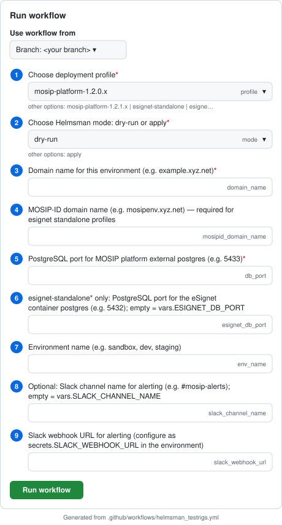

# Helmsman Testrigs Deployment Guide

Deploy API, UI, and DSL test rigs after all services are running and partner onboarding is complete.

## Overview

**Workflow:** `helmsman_testrigs.yml`  
**DSF:** `Helmsman/dsf/<profile>/testrigs-dsf.yaml`  
**Time required:** 10–20 minutes (`esignet-standalone-2.0.0`: up to ~45 minutes — its 3 UI testrigs each run headless Chrome + a JVM, which is slower than the API-only rigs)

---

## Profile Differences

| Profile | What deploys | Namespaces |
|---------|-------------|------------|
| `esignet-standalone` | Generic `mosip/apitestrig`/`mosip/uitestrig` charts: `esignet-apitestrig` into 3 namespaces; optional signup apitestrig + uitestrig | `esignet-mock`, `esignet-mosipid`, `esignet-sunbird`, `signup` |
| `esignet-standalone-2.0.0` | eSignet's own dedicated `mosip/esignet-apitestrig` (Go harness) + `mosip/esignet-uitestrig` (Java harness) charts — see note below; plus the same optional signup apitestrig/uitestrig as `esignet-standalone` | `esignet-mock`, `esignet-mosipid`, `esignet-sunbird`, `esignet-uitestrig`, `esignet-mosipid-uitestrig`, `esignet-sunbird-uitestrig`, `signup` |
| `mosip-platform-1.2.0.x` | API testrig, UI testrig, DSL testrig | MOSIP testrig namespaces |
| `mosip-platform-1.2.1.x` | Same as above | MOSIP testrig namespaces |

> **eSignet standalone (`esignet-standalone` / `esignet-standalone-2.0.0` profiles):** Requires `mosipid_domain_name` for the MOSIP-ID apitestrig endpoint.
>
> **`esignet-standalone-2.0.0` note:** Unlike the profile-differences doc gap this used to have, `testrigs-dsf.yaml` here does **not** deploy the same apps as `esignet-standalone` — it deploys eSignet's own reference testrig charts instead, modeled directly on
> [`esignet-apitestrig/install.sh`](https://github.com/mosip/esignet/blob/v2.0.0/deploy/esignet-apitestrig/install.sh) and
> [`esignet-uitestrig/install.sh`](https://github.com/mosip/esignet/blob/v2.0.0/deploy/esignet-uitestrig/install.sh). Each eSignet instance's apitestrig lives in that instance's own namespace (matching install.sh's `NS=esignet` pattern); each uitestrig gets its **own** namespace, separate from the eSignet instance it tests (matching install.sh's `NS=esignet-uitestrig` / `SOURCE_NS=esignet` split) — see [Required Secrets](#required-secrets) below for the extra values this needs. Only `esignet-mosipid` (the only instance backed by a real IDA identity) needs real test-identity values; `esignet-mock` and `esignet-sunbird` don't.

---

## Prerequisites

**All profiles:**
- All service pods from previous steps are in `Running` state
- Partner onboarding completed successfully (MOSIP platform profiles)

**eSignet standalone profile additionally:**
- eSignet DSF completed (`kubectl get ns default --show-labels | grep esignet-dsf`)
- Signup DSF completed if testing signup (`kubectl get ns default --show-labels | grep signup-dsf`)

---

## Required Secrets

All secrets are **Environment Secrets** — configure at **Repository → Settings → Environments → `<branch-name>` → Secrets**.

### All profiles

| Secret | Description |
|--------|-------------|
| `KUBECONFIG` | Raw YAML kubeconfig (not base64 encoded) |
| `CLUSTER_WIREGUARD_WG0` | WireGuard VPN config for cluster access |
| `SLACK_WEBHOOK_URL` | Slack incoming webhook URL (optional — for test result notifications) |

### `esignet-standalone` profile only

No additional secrets required for testrigs — captcha and keycloak secrets were already created during eSignet deployment and are available in each namespace.

### `esignet-standalone-2.0.0` profile only

`esignet-apitestrig`/`esignet-uitestrig` (eSignet's own reference charts) need a few values the generic testrig charts didn't. Some are read live from the cluster (no setup needed); the rest must be configured as **Environment Secrets/Variables**:

**Read automatically from the cluster** (already provisioned by eSignet's own deployment — nothing to add):

| Value | Source |
|-------|--------|
| `KEYCLOAK_CLIENT_SECRET` (apitestrig, `esignet-mock` and `esignet-sunbird`; mosipid uses `MOSIPID_TESTRIG_KEYCLOAK_CLIENT_SECRET` below) | `keycloak-client-secrets` secret in the `keycloak` namespace — the same `mosip_pms_client_secret` key `esignet-preinstall-keycloak-init.sh` already uses |
| `esignetDbPassword` (uitestrig, all 3 instances) | `db-common-secrets` secret in the `postgres` namespace |

**Optional Environment Secrets/Variables** (Settings → Environments → `<branch-name>`):

Except `MOSIPID_KEYCLOAK_ADMIN_PASSWORD` (already required by the eSignet deployment), each of these defaults to the dummy value `UPDATE_BEFORE_RUN` when unset, so Helmsman can deploy the testrigs without them. Update the real values in the testrig configmaps/secrets before triggering the test cronjobs.

Only actual credentials (passwords, client secrets) are **Secrets** below — everything else (IDs, test identities) is a plain **Variable**, even where it's technically PII, to keep the GitHub Environment setup simple.

| Secret/Variable | Type | Used by | Description |
|---|---|---|---|
| `MOSIPID_KEYCLOAK_ADMIN_PASSWORD` | Secret | uitestrig, all 3 instances | Reuses the same Keycloak admin password `esignet-misp-onboarder-mosipid-preinstall.sh` already needs — one shared `mosip/keycloak` release for the whole profile |
| `ESIGNET_UITESTRIG_OIDC_CLIENT_ID` | Variable | uitestrig, all 3 instances | Pre-provisioned OIDC client ID for browser login testing (reused across instances, same pattern as `mock-relying-party-service`'s shared `CLIENT_ID` in `esignet-dsf.yaml`) |
| `ESIGNET_UITESTRIG_CLIENT_SECRET` | Secret | uitestrig, all 3 instances | Secret for the client above |
| `MOSIPID_TESTRIG_INDIVIDUAL_ID` | Variable | apitestrig, `esignet-mosipid` only | Real IDA test identity (UIN) |
| `MOSIPID_TESTRIG_OTP_RECIPIENT` | Variable | apitestrig, `esignet-mosipid` only | Phone/email that receives the test OTP |
| `MOSIPID_TESTRIG_AUTH_PARTNER_ID` | Variable | apitestrig, `esignet-mosipid` only | Auth partner ID used to build the test client ID |
| `MOSIPID_TESTRIG_AUTH_POLICY_ID` | Variable | apitestrig, `esignet-mosipid` only | Policy ID used to build the test client ID |
| `MOSIPID_TESTRIG_UIN` | Variable | uitestrig, `esignet-mosipid` only | Test UIN |
| `MOSIPID_TESTRIG_VID` | Variable | uitestrig, `esignet-mosipid` only | Test VID |
| `MOSIPID_TESTRIG_PHONE_NUMBER` | Variable | uitestrig, `esignet-mosipid` only | Test UIN's phone number |
| `MOSIPID_TESTRIG_EMAIL_LOGIN_ID` | Variable | uitestrig, `esignet-mosipid` only | Test identity for email-OTP login scenarios |
| `MOSIPID_TESTRIG_PASSWORD_LOGIN_UIN` | Variable | uitestrig, `esignet-mosipid` only | Test identity for password-login scenarios |
| `MOSIPID_TESTRIG_PASSWORD_LOGIN_PASSWORD` | Secret | uitestrig, `esignet-mosipid` only | Password for the identity above |
| `MOSIPID_TESTRIG_KEYCLOAK_CLIENT_SECRET` | Secret | apitestrig, `esignet-mosipid` only | `mosip-pms-client` secret on the MOSIP-ID environment's Keycloak (`iam.<mosipid_domain_name>`), where its PMS lives. **Needed for the mosipid tests to pass**: the deploy works without it, but the run shows a warning and PMS logins fail. |
| `MOSIPID_TESTRIG_FLOW_CLIENT_ID` | Variable | apitestrig, `esignet-mosipid` only | OIDC client ID used by the flow tests |
| `MOSIPID_TESTRIG_TEST_PASSWORD` | Secret | apitestrig, `esignet-mosipid` only | Password for the test identity's password-login flows |
| `SUNBIRD_TESTRIG_INDIVIDUAL_ID` | Variable | apitestrig, `esignet-sunbird` only | Sunbird registry test identity |
| `SUNBIRD_TESTRIG_KBI_FULL_NAME` | Variable | apitestrig, `esignet-sunbird` only | Full name of that identity (knowledge-based login) |
| `SUNBIRD_TESTRIG_KBI_DOB` | Variable | apitestrig, `esignet-sunbird` only | Date of birth of that identity, `YYYY-MM-DD` |

The six apitestrig values above (`MOSIPID_TESTRIG_KEYCLOAK_CLIENT_SECRET`, `_FLOW_CLIENT_ID`, `_TEST_PASSWORD`, `SUNBIRD_TESTRIG_*`) default to **empty**, not `UPDATE_BEFORE_RUN`. The chart only sets an env var that has a value, so when one is unset the default from the image's `config.mosip.json` / `config.sunbird.json` applies.
| `ESIGNET_<INSTANCE>_CONFORMANCE_PLAN` | Secret | apitestrig, per instance | OpenID Conformance Suite plan JSON → `esignet-config.json` |
| `ESIGNET_<INSTANCE>_CONFORMANCE_PLAN_FAPI2` | Secret | apitestrig, per instance | FAPI2 plan JSON → `esignet-fapi2-config.json` |

`<INSTANCE>` is `MOCK`, `MOSIPID` or `SUNBIRD`. Each plan is a JSON object with the instance's `discoveryUrl` (`https://esignet[-mosipid|-sunbird].<domain>/.well-known/openid-configuration`), its registered client IDs and their **private JWKS**, so it is always a Secret. The apitestrig pre-install/pre-upgrade hook (`apitestrig-conformance-plan.sh`) writes both into the `esignet-conformance-plan` Secret in the instance namespace. Once that Secret holds a real plan, the **cluster value is kept**: the GitHub secret only seeds an empty or dummy plan, and a differing GitHub value is ignored with a warning. So a plan edited on the cluster is never overwritten. Plans are compared as JSON, so formatting differences don't count. A cluster value that isn't valid JSON is replaced. An unchanged Secret is not rewritten, and labels and annotations added outside the hook are kept. If neither has a plan, the hook writes the dummy `{"alias":"UPDATE_BEFORE_RUN"}`; the deployment still succeeds and only the `conformance` surface fails until a real plan is set. Invalid JSON (anything but a single JSON object) fails the hook, and so does a failed read of the existing Secret. The hook runs only when Helmsman installs or upgrades the apitestrig release (new install, chart version or values change); it also removes a `last-applied-configuration` annotation left by earlier versions that used `kubectl apply`. The MinIO `root-user` and `root-password` must be alphanumeric (`A-Z`, `a-z`, `0-9`), because the report uploader puts them into a URL unencoded; the workflow checks this (the chart-generated password already is).

**Changing a plan on the cluster.** Do **not** delete the Secret (or a key) and re-deploy: with unchanged chart and values, Helmsman skips the apitestrig release, the hook never runs, and the Secret stays missing, so restarted testrig pods can't mount it. Replace both keys in place instead (namespace `esignet-mock`, `esignet-mosipid` or `esignet-sunbird`):

```bash
NS=esignet-mock
kubectl -n "$NS" create secret generic esignet-conformance-plan \
  --from-file=esignet-config.json=./esignet-config.json \
  --from-file=esignet-fapi2-config.json=./esignet-fapi2-config.json \
  --dry-run=client -o json | kubectl -n "$NS" replace -f -
```

Use `kubectl replace`, not `kubectl apply`, so the plans don't end up in the `last-applied-configuration` annotation. The next upgrade keeps this plan.

`esignet-mosipid` uses a real IDA identity (`config.mosip.json`/the `mosip` plugin) and `esignet-sunbird` a Sunbird registry identity (`config.sunbird.json`); `esignet-mock` (`config.mock.json`) needs no test identity.

There is no validation step for these values; the placeholder defaults let the deployment succeed.

**apitestrig runtime (all 3 instances):**
- Surfaces `conformance,api,e2e`. The OpenID Conformance Suite (mongodb, server, nginx) runs as extra containers in the testrig pod at `https://localhost.emobix.co.uk:8443`.
- Reports are uploaded to the in-cluster MinIO (`http://minio.minio:9000`, user and password read from the `minio` secret's `root-user` / `root-password`, both must be alphanumeric) in buckets `esignet-mock`, `esignet-mosipid` and `esignet-sunbird`, created on first upload. No PVC is used: reports sit in an `emptyDir` until uploaded, so **if an upload fails, that run's reports are lost** (the next run produces new ones).
- Schedules: mock 01:00, mosipid 02:00, sunbird 03:00 (cluster time).

### MOSIP platform profiles only

No additional secrets required — MinIO root password is read automatically from the `minio` secret in the `minio` namespace (`kubectl -n minio get secret minio`).

---

## Workflow Inputs

### All profiles

| Input | Description | Example |
|-------|-------------|---------|
| `profile` | Deployment profile | `esignet-standalone` / `esignet-standalone-2.0.0` / `mosip-platform-1.2.0.x` / `mosip-platform-1.2.1.x` |
| `mode` | Helmsman mode | Always `apply` — dry-run will fail |
| `domain_name` | Base domain for this environment | `soil38.mosip.net` |
| `db_port` | External postgres port — `mosip-platform-*` only; optional, leave blank for `esignet-standalone*` | `5433` |
| `esignet_db_port` | eSignet container postgres port — `esignet-standalone*` only; optional, leave blank for `mosip-platform-*` | `5432` |
| `env_name` | Environment name | `soil38` |
| `slack_channel_name` | Slack channel for alerting (optional) | `#mosip-alerts` |

### eSignet standalone profiles (`esignet-standalone` / `esignet-standalone-2.0.0`) additionally

| Input | Description | Example |
|-------|-------------|---------|
| `mosipid_domain_name` | Domain for the MOSIP-ID eSignet instance | `mosipid.mosip.net` |

> If not provided as an input, the value falls back to the GitHub Environment Variable `vars.MOSIPID_DOMAIN_NAME`.

---

## Step-by-Step: Run the Workflow



> Generated from the workflow definition — the numbers match the form fields in order.

- Go to **Actions** (top of the repository page) → click **"Deploy Testrigs of mosip using Helmsman"** in the list on the left.
  > Can't find it? Search for "Testrig" or "Testrigs" in the workflows list.
- Click the **Run workflow** dropdown button (top right) — this opens the form shown above.
- **Branch** — pick the branch you're deploying from (e.g., `MOSIP-44613`).
- **(1)** **Deployment profile to use** — pick the profile you want (e.g., `mosip-platform-1.2.0.x`, `esignet-standalone`, or `esignet-standalone-2.0.0` for the Go rewrite).
- **(2)** **Choose Helmsman mode: dry-run or apply** — always pick **`apply`**.
- **(3)** **Domain name for this environment** — type the web domain this environment should use (e.g., `example.xyz.net`).
- **(4)** **MOSIP-ID domain name** *(eSignet profile only)* — type the base domain used by the MOSIP-ID eSignet instance (e.g., `mosipid.xyz.net`). Leave blank for MOSIP platform profiles.
- **(5)** **PostgreSQL port for MOSIP platform external postgres** — only fill this in if you picked a `mosip-platform-*` profile in field 1. Type `5433` (or whatever port your external PostgreSQL uses).
- **(6)** **PostgreSQL port for esignet standalone container postgres** — only fill this in if you picked the `esignet-standalone` profile in field 1. Type `5432`.
- **(7)** **Environment name** — a short nickname for this environment (e.g., `sandbox`, `dev`, `staging`).
- **(8)** **Slack channel name for alerting** (optional) — the Slack channel that should receive test result notifications (e.g., `#mosip-alerts`). Leave blank if you don't want Slack alerts.
- **(9)** **Slack webhook URL for alerting** (optional) — leave this blank; it's normally already saved as the `SLACK_WEBHOOK_URL` secret in your GitHub environment.
- Click the green **Run workflow** button to start the deployment.

> **Note:** Fields 4–6 all appear in the form regardless of which profile you picked — fill in only the ones that match your profile (MOSIP-ID domain for `esignet-standalone`, PostgreSQL port for `mosip-platform-*`) and leave the rest blank.

> **Important:** Always pass `--keep-untracked-releases` — without it Helmsman will delete releases from previous DSFs (esignet, oidc-ui, etc.) that aren't listed in `testrigs-dsf.yaml`. The workflow handles this automatically.

---

## Post-Deployment Steps

After testrigs deploy successfully:

**1. Update cron schedules**

Update the cron time for CronJobs in the testrig namespaces to match your desired schedule:

```bash
# List all cronjobs across testrig namespaces
kubectl get cronjobs -n apitestrig
kubectl get cronjobs -n uitestrig
kubectl get cronjobs -n dslrig

# For eSignet standalone
kubectl get cronjobs -n esignet
kubectl get cronjobs -n esignet-mosipid
kubectl get cronjobs -n esignet-sunbird

# esignet-standalone-2.0.0 only — separate uitestrig namespaces
kubectl get cronjobs -n esignet-uitestrig
kubectl get cronjobs -n esignet-mosipid-uitestrig
kubectl get cronjobs -n esignet-sunbird-uitestrig
```

**2. Trigger DSL orchestrator (MOSIP platform profiles)**

```bash
kubectl create job --from=cronjob/cronjob-dslorchestrator-full dslrig-manual-run -n dslrig
```

> This job runs for 3+ hours. Monitor progress:
> ```bash
> kubectl logs -f job/dslrig-manual-run -n dslrig
> ```

**3. Trigger eSignet test jobs (eSignet standalone profiles)**

Test cronjobs are not triggered automatically after deployment. For `esignet-standalone`, trigger them with `trigger-test-jobs-esignet.sh` (all cronjobs across the esignet namespaces, plus signup/signup-uitestrig if deployed). For `esignet-standalone-2.0.0`, update the testrig values first, then trigger the cronjobs manually (for example `kubectl -n <namespace> create job --from=cronjob/<cronjob> <job-name>`).

To trigger the `esignet-standalone` jobs:

```bash
export KUBECONFIG=/path/to/kubeconfig
export WORKDIR=/path/to/Helmsman

./hooks/esignet-standalone/trigger-test-jobs-esignet.sh
```

---

## Verify

```bash
# Check testrig pods (MOSIP platform)
kubectl get pods -n apitestrig
kubectl get pods -n uitestrig
kubectl get pods -n dslrig

# Check testrig pods (eSignet standalone apitestrig — same namespaces for esignet-standalone-2.0.0)
kubectl get pods -n esignet      # esignet-apitestrig cronjob
kubectl get pods -n esignet-mosipid
kubectl get pods -n esignet-sunbird
kubectl get pods -n signup       # signup-apitestrig (if enabled)

# esignet-standalone-2.0.0 only — separate uitestrig namespaces
kubectl get pods -n esignet-uitestrig
kubectl get pods -n esignet-mosipid-uitestrig
kubectl get pods -n esignet-sunbird-uitestrig
```
